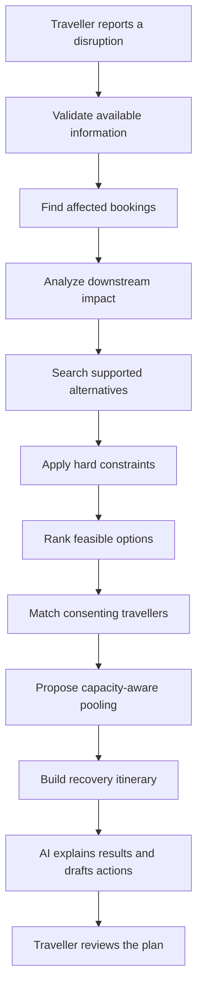
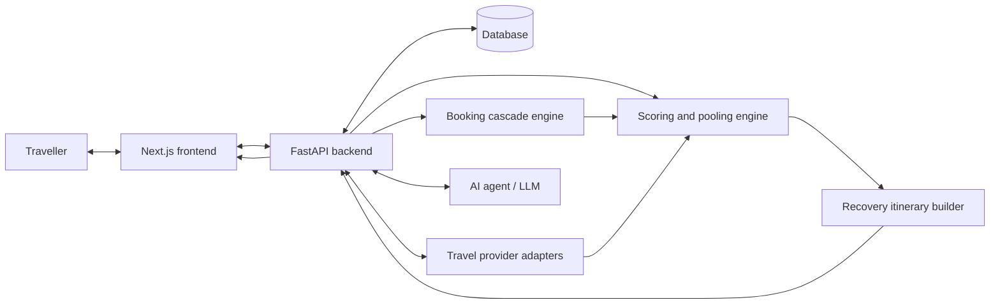

<div align="center">


# 🚆 StrandedPool

### Predict. Pool. Recover.

**An AI-powered travel disruption recovery platform.**

When trains are cancelled, flights are delayed, or severe weather disrupts journeys, StrandedPool helps travellers understand what is affected, explore feasible alternatives, and coordinate recovery with others heading the same way.

<br>

[](#-project-status)
[](https://nextjs.org/)
[](https://fastapi.tiangolo.com/)
[](#-how-it-works)

[Features](#-key-features) · [Architecture](#️-architecture) · [Screenshots](#-screenshots) · [Setup](#-getting-started) · [Roadmap](#️-roadmap)

</div>

---

## 🌍 The Problem

One disruption can break an entire itinerary. A cancelled train may lead to a missed cab pickup, a risky hotel check-in, or a missed appointment. Meanwhile, many passengers affected by the same event compete for the same limited alternatives.

Most travel search experiences focus on finding an option for one traveller at a time. StrandedPool explores a group-aware approach: understand the downstream impact, evaluate alternatives against each traveller’s constraints, and identify opportunities to recover together.

## 💡 The Solution

StrandedPool combines **travel-data integrations, deterministic planning, group pooling, and an AI assistant** in one recovery workflow.

- **Predict:** surface weather and travel-risk signals when supported data is available.
- **Analyze:** identify bookings that may be affected by a disruption.
- **Recover:** search and rank alternatives using budget, timing, destination, and capacity constraints.
- **Pool:** propose shared transport for compatible travellers who consent.
- **Communicate:** create a recovery itinerary and editable messages for hotels, transport providers, and refund inquiries.

> **Design principle:** code verifies data and enforces constraints; AI helps interpret requests and explain results. The assistant must not invent fares, seats, operational status, or booking confirmations.

## ✨ Key Features

<table>
<tr>
<td width="50%" valign="top">

### 🔎 Disruption awareness
- Disruption reporting and simulation workflows
- Weather and travel-data provider integrations
- Clear distinction between live, cached, reported, and simulated information

### 🧩 Booking cascade analysis
- Linked journey and booking dependencies
- Downstream impact analysis
- Explanations for at-risk connections, pickups, and check-ins

### 🧭 Alternative evaluation
- Budget and deadline constraints
- Destination and capacity checks
- Ranked feasible options with transparent trade-offs

</td>
<td width="50%" valign="top">

### 👥 Traveller pooling
- Compatible journey matching
- Shared-cab proposals
- Capacity-aware allocation and consent
- Aggregated unmet-demand insights

### 🗺️ Recovery itinerary
- Original vs. proposed journey timeline
- Affected bookings and suggested next steps
- Estimated additional cost and uncertainty

### 💬 AI-assisted action pack
- Natural-language explanations
- Editable hotel and pickup messages
- Refund inquiry drafts
- Designed for English, Hindi, and Kannada support

</td>
</tr>
</table>

*Feature availability depends on the current implementation and connected provider access. Update this section as features are verified in the running application.*

## 🔄 How It Works



## 🏗️ Architecture



### Hybrid AI approach

| Component | Responsibility |
|---|---|
| Deterministic backend | Validation, booking impact, constraints, scoring, and allocation |
| Provider adapters | Retrieve and normalize information from supported data sources |
| AI agent | Understand traveller requests, explain grounded results, and draft messages |
| Database | Persist trips, bookings, disruptions, and recovery plans |
| Frontend | Present alerts, alternatives, pooling proposals, and recovery timelines |

## 🖼️ Screenshots

> Add screenshots from your actual running application to the `docs/screenshots/` folder. These placeholders are ready to replace when your UI is finalized.

<table>
<tr>
<td width="50%" valign="top">

**1. Dashboard**


*Overview of trips, disruption alerts, and recovery activity.*

</td>
<td width="50%" valign="top">

**2. Disruption & cascade analysis**


*Show affected bookings and explain the downstream impact.*

</td>
</tr>
<tr>
<td width="50%" valign="top">

**3. Alternatives & pooling**


*Compare feasible options and proposed shared transport.*

</td>
<td width="50%" valign="top">

**4. Recovery itinerary**


*Compare the original journey with the proposed recovery plan.*

</td>
</tr>
</table>

### Add your own screenshots

1. Create `docs/screenshots/` in the repository.
2. Save screenshots as `dashboard.png`, `cascade-analysis.png`, `pooling.png`, and `recovery-itinerary.png`.
3. Replace the corresponding placeholder image URLs above with these paths:

```markdown


```

## 🧰 Technology Stack

| Layer | Technologies |
|---|---|
| Frontend | Next.js, React, TypeScript, Tailwind CSS |
| Backend | Python, FastAPI, Pydantic |
| Persistence | SQLAlchemy, SQLite for local development, PostgreSQL for production where configured |
| Migrations | Alembic, if configured |
| AI | Gemini API or another configured LLM provider |
| Optimization | Python; OR-Tools where implemented |
| Weather | Open-Meteo |
| Railway data | Authorized railway data provider, subject to endpoint access |
| Flight search | Amadeus Self-Service APIs, subject to plan and environment |
| Routing | OpenRouteService or Google Maps Platform, depending on configuration |
| Testing | Pytest, HTTPX, frontend checks, and Playwright where configured |

## 🌐 Data Sources & Reliability

Potential integrations include:

- [Open-Meteo](https://open-meteo.com/) — weather forecasts; standard non-commercial access generally does not require a key.
- [Qrail Developers](https://www.qrail.in/developers) — railway information, subject to available endpoints and plan limits.
- [Amadeus for Developers](https://developers.amadeus.com/) — supported flight search APIs; test data may be limited or cached.
- [OpenRouteService](https://openrouteservice.org/) / [Google Maps Platform](https://developers.google.com/maps) — routing options with provider-specific limits and terms.
- [Google AI Studio](https://aistudio.google.com/apikey) — Gemini API credentials.

Provider quotas, live access, pricing, and commercial-use permissions can change. Bus, cab, and hotel inventory may require an approved partner API.

**Data must be labelled honestly:** live verified, scheduled, cached, user-reported, simulated, or unavailable. A weather risk is not proof of a cancellation, and a proposed itinerary is not a confirmed booking.

## 🚀 Getting Started

These commands assume the repository contains `frontend/` and `backend/`. Use the actual entry point and scripts present in your project.

### Prerequisites
- Git
- Node.js compatible with the project's Next.js version
- Python version supported by `requirements.txt`
- Optional API keys for enabled providers

### 1. Clone

```bash
git clone <YOUR_REPOSITORY_URL>
cd StrandedPool
```

### 2. Backend

```bash
cd backend
python -m venv .venv
```

Activate on Windows PowerShell:

```powershell
.\.venv\Scripts\Activate.ps1
```

Activate on macOS/Linux:

```bash
source .venv/bin/activate
```

Install and run:

```bash
pip install -r requirements.txt
uvicorn app.main:app --reload --port 8000
```

If your FastAPI entry point differs, adjust the `uvicorn` module path. API documentation is typically available at `http://127.0.0.1:8000/docs`.

### 3. Frontend

Open a second terminal:

```bash
cd frontend
npm install
npm run dev -- --port 3001
```

Open `http://localhost:3001` if that port is available; otherwise use the URL printed by Next.js.

### 4. Environment variables

Use the repository's `.env.example` files and configure only variables used by your implementation. Example backend variables may include:

```dotenv
APP_ENV=development
DATABASE_URL=sqlite:///./strandedpool.db
GEMINI_API_KEY=
AMADEUS_CLIENT_ID=
AMADEUS_CLIENT_SECRET=
```

Never commit `.env` files or expose private keys through `NEXT_PUBLIC_` variables. Keep secrets on the backend and use your hosting provider's secret manager in production.

## 🧪 Testing

Run the commands supported by your repository.

Backend:

```bash
cd backend
pytest
```

Frontend:

```bash
cd frontend
npm run
npm run lint
npm run build
```

Only run scripts that exist in `package.json`. For a full demo, verify trip creation, disruption analysis, cascade results, constraint filtering, pooling capacity, itinerary persistence, and graceful handling of provider failures.

## 🎬 Demo Scenario

The dashboard uses button-based **Overview**, **My trip**, **Recovery**, and **History** sections, so the main workflow is available without scrolling through every feature.

Use **My trip** to enter your actual journey and bookings, then use **Recovery** to record a traveller-reported disruption, assess downstream effects, add alternatives you have checked, and create a proposed recovery plan. **History** displays records saved to the signed-in account. Editable action messages are not persisted and are never sent automatically.

No transport-inventory provider is currently connected. The application does not seed or claim fictional records as real trips, bookings, disruption reports, fares, or availability. Journey and booking details are traveller-entered and unverified; proposals remain unbooked until confirmed directly with a provider. To demonstrate the workflow, use records you are authorized to share and label any illustrative values as sample data.

Evaluate pooling against a non-pooling baseline using the same dataset. Publish actual measured results and label simulated metrics accordingly—do not invent percentages or live availability.

## 🔐 Security & Privacy

- Enforce authentication and user-level authorization for private trips and bookings.
- Hash passwords securely if accounts are implemented.
- Validate user input and protect API credentials.
- Avoid logging sensitive booking information.
- Respect traveller consent for pooling.
- Do not expose individual details in aggregated demand reports.
- Require user review and authorization before sending messages or changing bookings.

## 🗺️ Roadmap

- [ ] Verify live travel-provider integrations
- [ ] Complete booking cascade analysis
- [ ] Validate constraint-based alternative ranking
- [ ] Complete consent-aware pooling and allocation
- [ ] Verify AI tool-calling and multilingual workflows
- [ ] Complete automated end-to-end tests
- [ ] Deploy frontend, backend, and production database
- [ ] Add real application screenshots and measured demo results

Mark items complete only after the corresponding functionality has been tested.

## 🤝 Contributing

1. Fork the repository.
2. Create a feature branch.
3. Make a focused change and add tests.
4. Run relevant checks.
5. Open a pull request describing the change and test results.

## 👥 Team & Links

- **Team:** `<YOUR_TEAM_NAME>`
- **Problem Statement:** PS 4.1 — AI Agent for Travel Disruption Recovery
- **GitHub:** `<YOUR_REPOSITORY_URL>`
- **Demo video:** `<YOUR_DEMO_URL>`
- **Deployment:** `<YOUR_DEPLOYMENT_URL>`

## 📄 License

Add a suitable open-source license before inviting reuse or redistribution. Until a license is selected, reuse permissions should not be assumed.

---

<div align="center">

### 🚆 StrandedPool

**When plans change, find your next move.**

*Built to make travel recovery smarter, fairer, and more connected.*

</div>
